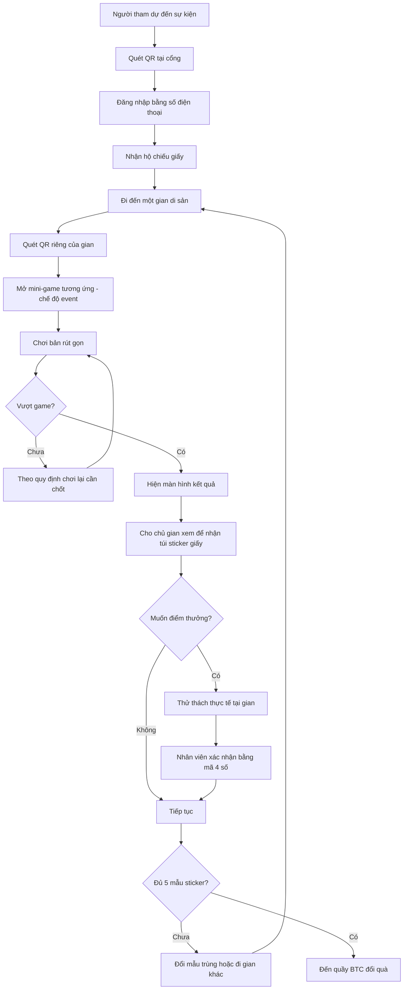
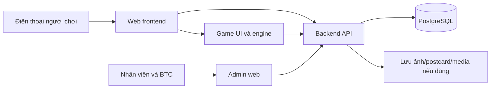

# HỘ CHIẾU DI SẢN — GAME QR TẠI GLOBAL CITIZEN DAY 2026

> **Tài liệu giải thích dự án và phân rã yêu cầu triển khai**  
> Phiên bản: 1.0 — 12/11/2026  
> Tài liệu gốc: *Hộ chiếu Di sản - Game QR tại Global Citizen Day 2026*, 19 trang.  
> Sự kiện: **05/12/2026**, Hội trường Nguyễn Văn Đạo, ĐHQGHN — JCI Thăng Long.

## 0. Cách đọc tài liệu

- **[Đã nêu trong đề xuất]**: nội dung xuất hiện trong PDF gốc.
- **[Đề xuất triển khai]**: diễn giải, thiết kế hệ thống hoặc giải pháp kỹ thuật được gợi ý thêm; **chưa phải quyết định của BTC**.
- **[Cần xác nhận]**: chỗ còn thiếu quy định, hoặc có nguy cơ hiểu khác nhau, cần chốt trước khi lập trình.

Tài liệu này là bản giải thích và đặc tả bước đầu để nhóm sản phẩm, thiết kế, frontend, backend và đội vận hành thống nhất cách hiểu. **Không nên xem nó là bản đặc tả được BTC phê duyệt.**

---

## 1. Tóm tắt dự án trong một phút

**Hộ chiếu Di sản** là một **web game chơi trên điện thoại, không cần cài app**, kể hành trình một người trẻ tìm lại bản sắc di sản Việt Nam thông qua **5 mini-game**. Trò chơi có **hai giai đoạn liên kết**:

| Hạng mục | Giai đoạn online | Giai đoạn tại sự kiện |
|---|---|---|
| Thời gian | 24/11–04/12/2026 | 05/12/2026 |
| Truy cập | Link web hoặc QR trên poster | QR ở cổng và QR riêng tại 5 gian |
| Trải nghiệm | 5 chặng, lần lượt mở theo lịch | Cùng 5 trò chơi dưới dạng rút gọn, khoảng 90 giây/gian |
| Người chơi | Tạo nhân vật, nhập thông tin, nhận hộ chiếu số | Đăng nhập lại qua số điện thoại, nhận hộ chiếu giấy |
| Điểm thưởng | Điểm mini-game, chuỗi ngày, thách đấu | Điểm phiên sự kiện, điểm thưởng thử thách thực tế |
| Vật phẩm | Con dấu/sticker số và thẻ chia sẻ | Sticker giấy túi mù, đổi mẫu và đổi quà |
| Mục tiêu | Tạo quan tâm, kéo người chơi đến sự kiện, thi đua trường/CLB | Khuyến khích người tham dự đi qua 5 gian di sản |

**Điều dễ nhầm nhất:** Quét QR ở gian **không phải** chỉ để check-in hay nhận sticker. Theo đề xuất, QR **mở mini-game của chính gian đó**. Người chơi **chơi trên điện thoại**, xuất trình kết quả cho chủ gian để nhận sticker. Sau đó **có thể** chơi thêm thử thách vật lý ngay tại gian để nhận điểm thưởng.

---

## 2. Ý tưởng cốt truyện và cơ chế tiến trình

### 2.1. Câu chuyện

Thông điệp: **“Muốn đi xa, phải biết mình từ đâu đến.”**

Chú Tễu trao cho người chơi một cuốn **hộ chiếu trống**. Một lớp **Sương Quên** đang che phủ bản đồ di sản, khiến nhân vật ban đầu chỉ là **bóng mờ**. Mỗi chặng hoàn thành sẽ trả lại một phần cơ thể/khả năng tượng trưng của nhân vật:

1. **Đôi tay** — nghề thủ công/làng nghề Hà Nội.
2. **Đôi mắt** — tranh dân gian Đông Hồ.
3. **Đôi tai** — di sản âm nhạc/trình diễn: Quan họ, Ca trù, Chèo, Xẩm.
4. **Đôi chân** — xác định vị trí di sản thế giới tại Việt Nam.
5. **Tiếng nói** — giới thiệu một di sản Việt Nam ra thế giới.

Đủ 5 dấu, nhân vật hiện ra trọn vẹn, biểu trưng một người trẻ có gốc rễ, tự tin hội nhập.

### 2.2. Vòng lặp chơi chính (core loop)

```text
Mở web
  → Đăng ký / đăng nhập
  → Nhận nhân vật + hộ chiếu
  → Chọn chặng đang mở
  → Đọc đoạn truyện ngắn
  → Chơi mini-game
  → Ghi kết quả, tính điểm
  → Vượt chặng → nhận con dấu + túi sticker số
  → Nhân vật khôi phục một phần
  → Xem hạng / chia sẻ / chờ chặng tiếp theo
```

**[Đã nêu trong đề xuất]** Người chơi có thể chơi lại; hệ thống lấy **điểm cao nhất của mỗi chặng**.

---

## 3. Trải nghiệm GIAI ĐOẠN ONLINE (24/11–04/12)

### 3.1. Đăng ký và tạo nhân vật

Người chơi mở link hoặc quét QR truyền thông. Màn hình mở đầu cho nhập:

- Tên nhân vật;
- Số điện thoại;
- Email;
- Trường hoặc câu lạc bộ (CLB).

**Vai trò thông tin:** Theo tài liệu, số điện thoại là khóa để **giữ điểm từ online sang ngày 05/12**; email để gửi lời mời và thẻ tổng kết.

**Note** Không cần xác thực OTP

### 3.2. Mở khóa chặng theo lịch

- 24/11: ra mắt, **mở chặng 1**.
- 26/11–02/12: **hai ngày mở một chặng** theo kế hoạch truyền thông.
- 04/12: khóa bảng xếp hạng online, phát thẻ tổng kết, chuẩn bị vật phẩm.

**[Cần xác nhận]** PDF chưa liệt kê lịch chính xác cho từng chặng 2–5 (mốc “hai ngày một chặng” có thể suy ra lịch dự kiến, nhưng phải chốt giờ mở và khóa). Chưa rõ chặng cũ còn chơi được khi chặng mới mở không.

### 3.3. Nhận con dấu, sticker và bảng xếp hạng

Mỗi lần vượt một chặng:

1. Ghi điểm và kiểm tra nếu đó là kỷ lục cá nhân.
2. Nhận dấu ứng với bộ phận nhân vật.
3. Mở **một túi mù sticker số** (bản thường hoặc bản hiếm ánh kim).
4. Nhân vật sáng rõ hơn một phần.
5. Có thể xem xếp hạng cá nhân và của trường/CLB, chia sẻ thành tích.

---

## 4. Chi tiết NĂM MINI-GAME

> Đây là **5 gameplay khác nhau**, không phải 5 câu hỏi trắc nghiệm. Ở sự kiện, cùng mỗi gameplay được cấu hình một phiên bản ngắn hơn.

### 4.1. Chặng 1 — TIỆM BÁCH NGHỆ (Dấu Đôi tay)

**Chủ đề:** Làng nghề Hà Nội. Người chơi xin học việc ở tiệm thủ công, hiểu rằng di sản sống trong đôi tay người thợ.

**Gameplay:** Khách bước vào và gọi một loại sản phẩm. Người chơi nhìn các vật phẩm đang có, **chạm chọn đúng sản phẩm ứng với làng nghề**, sau đó **giao hàng** trước khi khách hết kiên nhẫn.

**Luật ONLINE [Đã nêu trong đề xuất]:**

- Có **5 đơn hàng trong 60 giây**.
- Giao đúng liên tiếp tạo **combo nhân điểm**; giao sai làm mất chuỗi.
- **Hoàn thành đúng 4 đơn** thì vượt chặng.

**Bản SỰ KIỆN [Đã nêu trong đề xuất]:** **Giao 3 đơn** trên điện thoại. Thời lượng chung tại gian khoảng 90 giây, chưa có quy định riêng về đồng hồ game của bản rút gọn.

**Thử thách thực tế:** Sờ và đoán chất liệu bên trong hộp kín.

**Ví dụ minh họa [Đề xuất triển khai]:** Khách gọi “bình gốm Bát Tràng”. Trong 3 lựa chọn bình gốm, giỏ mây, quạt giấy, người chơi chọn bình gốm rồi bấm “Giao hàng”. Các vật phẩm ví dụ này **chưa phải danh sách sản phẩm chính thức**.

**[Cần xác nhận]:** Danh sách làng nghề/sản phẩm, quy tắc xuất hiện khách hàng, số điểm mỗi đơn và thời gian dành cho bản sự kiện.

### 4.2. Chặng 2 — XẾP VÁN ĐÔNG HỒ (Dấu Đôi mắt)

**Chủ đề:** Tranh dân gian Đông Hồ. Bức tranh bị Sương Quên xóa trắng, cần in nhiều lớp màu để khôi phục.

**Gameplay:** Bảng gồm **8×8 ô**. Người chơi **kéo các khối màu** và thả lên ván. Khi lấp đầy một hàng, một lớp màu được hoàn thành; hoàn thành nhiều lớp sẽ làm hiện tranh.

**Luật ONLINE [Đã nêu trong đề xuất]:**

- **Không giới hạn thời gian**.
- Nếu **không còn chỗ để đặt khối**, lượt chơi dừng.
- **Hoàn thành 2 lớp** thì vượt chặng.
- **Đủ 4 lớp** thì bức tranh hiện ra, trong đó **nét đen là lớp cuối**.

**Bản SỰ KIỆN:** In xong **1 lớp màu** trên điện thoại.

**Thử thách thực tế:** Tự tay in một lớp màu bằng ván khắc thật.

**[Cần xác nhận]:** Cơ chế xóa hàng khác gì Block Blast thông thường, sinh khối thế nào, có cho xoay khối không, nội dung tranh và cách chấm điểm.

### 4.3. Chặng 3 — BẮT NHỊP DI SẢN (Dấu Đôi tai)

**Chủ đề:** Quan họ, Ca trù, Chèo, Xẩm. Bài học: muốn cất tiếng trước hết phải biết lắng nghe.

**Gameplay:** Nhạc phát, các nốt rơi xuống theo nhịp phách. Người chơi **chạm đúng lúc nốt chạm vạch** (rhythm game).

**Luật ONLINE [Đã nêu trong đề xuất]:**

- Một đoạn nhạc **30 giây**.
- Chấm ba mức: **Tuyệt / Được / Trượt**.
- Combo càng dài, điểm càng cao.
- **Chạm đúng ít nhất 60% số nốt** để vượt chặng.

**Bản SỰ KIỆN:** Giữ nhịp **30 giây** trên điện thoại.

**Thử thách thực tế:** Gõ phách theo nghệ nhân trong **15 giây**.

**Lưu ý [Đã nêu trong đề xuất]:** Cần bản thu có **quyền sử dụng**; gợi ý thu riêng cùng nghệ nhân.

**[Cần xác nhận]:** Track nhạc, số lane và nốt, độ lệch nhịp được tính từng mức, cách vận hành trên nhiều loại điện thoại, xử lý nhạc không tự phát do chính sách trình duyệt.

### 4.4. Chặng 4 — ĐÂY LÀ ĐÂU? (Dấu Đôi chân)

**Chủ đề:** Di sản thế giới tại Việt Nam. Người chơi nhìn ảnh di sản rồi xác định địa điểm trên bản đồ.

**Gameplay:** Hiển thị ảnh **không kèm tên di sản**. Người chơi chọn **một điểm trên bản đồ** để đặt ghim. Điểm càng gần vị trí thật càng cao.

**Luật ONLINE [Đã nêu trong đề xuất]:**

- **3 ảnh/lượt**, mỗi ảnh **20 giây**.
- **Vượt khi có ít nhất 2 ảnh** được ghim sai lệch **dưới 100 km**.

**Bản SỰ KIỆN:** Ghim vị trí cho **2 ảnh** trên điện thoại.

**Thử thách thực tế:** Gắn cờ di sản quê mình lên bản đồ lớn tại gian.

**Lưu ý [Đã nêu trong đề xuất]:** Bản đồ trong game phải là bản đồ chuẩn, có **Hoàng Sa và Trường Sa**.

**[Cần xác nhận]:** Danh sách ảnh và tọa độ đích, công thức khoảng cách km, cách xử lý đảo/quần đảo, thư viện dữ liệu bản đồ và nguồn hình ảnh có bản quyền.

### 4.5. Chặng 5 — ĐẠI SỨ DI SẢN (Dấu Tiếng nói)

**Chủ đề:** Di sản tự chọn. Người chơi giới thiệu di sản Việt Nam với bạn bè quốc tế.

**Gameplay:** Chọn khung **postcard**, viết một câu tiếng Anh giới thiệu di sản. Người chơi **có thể** quay clip **15 giây** đọc câu đó.

**Luật ONLINE [Đã nêu trong đề xuất]:**

- Nội dung **tối đa 20 từ**.
- **BTC phải duyệt** trước khi postcard hiển thị trên tường postcard.
- Postcard được bình chọn nhiều nhất **mỗi ngày** nhận sticker hiếm.

**Bản SỰ KIỆN:** Viết postcard trên điện thoại.

**Thử thách thực tế:** Nói **30 giây tiếng Anh** giới thiệu một di sản.

**[Cần xác nhận]:** Điều kiện nào tính là “vượt chặng”; cách chấm tối đa 200 điểm cho bài viết sáng tạo; có bắt buộc duyệt trước khi phát dấu không; có cần tải clip lên server hay chỉ quay tại chỗ; quy tắc bỏ phiếu và chống spam.

### 4.6. So sánh 5 game ở hai giai đoạn

| # | Mini-game | Chế độ online | Chế độ sự kiện trên điện thoại | Thử thách thực tế (tùy chọn) |
|---|---|---|---|---|
| 1 | Tiệm Bách nghệ | 5 đơn/60s, đúng 4 đơn | Giao 3 đơn | Sờ đoán chất liệu |
| 2 | Xếp ván Đông Hồ | Ván 8×8, vượt khi 2 lớp | In 1 lớp | In với ván khắc thật |
| 3 | Bắt nhịp di sản | Nhạc 30s, đúng ≥60% | Giữ nhịp 30s | Gõ phách 15s |
| 4 | Đây là đâu? | 3 ảnh × 20s, 2 ảnh lệch <100 km | Ghim 2 ảnh | Gắn cờ lên bản đồ lớn |
| 5 | Đại sứ di sản | Postcard tiếng Anh ≤20 từ; có thể quay 15s | Viết postcard | Thuyết trình tiếng Anh 30s |

---

## 5. Giai đoạn TẠI SỰ KIỆN — giải thích chính xác vai trò của QR

### 5.1. Có những QR nào?

**Theo tài liệu:**

1. **QR tại cổng:** mở luồng đăng nhập/check-in bằng số điện thoại và nhận hộ chiếu giấy.
2. **QR riêng ở từng gian:** QR gian 1 mở game 1; QR gian 2 mở game 2; ...; QR gian 5 mở game 5.

**[Đề xuất triển khai]** Tạo URL dạng:

```text
https://game.example.com/event/check-in
https://game.example.com/event/stages/1
https://game.example.com/event/stages/2
https://game.example.com/event/stages/3
https://game.example.com/event/stages/4
https://game.example.com/event/stages/5
```

`game.example.com` là tên miền **minh họa**, không phải URL thật của sự kiện. QR chứa đường dẫn tới đúng màn hình/chặng và phiên bản `event`.

### 5.2. Luồng của một người chơi ở gian 1 — ví dụ từng bước

1. Người tham dự đã vào sự kiện, có thể đã chơi online hoặc chưa (**trường hợp chưa chơi cần BTC chốt cơ chế**).
2. Đến gian **Tiệm Bách nghệ**, dùng camera điện thoại **quét QR** dán tại gian.
3. Trình duyệt mở mini-game **Tiệm Bách nghệ — chế độ sự kiện**.
4. Nếu chưa có phiên đăng nhập, **[Đề xuất triển khai]** chuyển tới đăng nhập bằng số điện thoại rồi quay trở lại mini-game.
5. Game hiện yêu cầu giao **3 đơn hàng**. Người chơi thao tác chọn/giao sản phẩm trên **chính điện thoại của họ**.
6. Sau khi vượt game, màn hình hiển thị **kết quả hoàn thành**.
7. Người chơi **đưa màn hình kết quả cho chủ gian**.
8. Chủ gian **phát một túi sticker giấy**. Tài liệu không yêu cầu làm thử thách thực tế mới được nhận sticker.
9. Nếu muốn có thêm điểm, người chơi làm **thử thách sờ và đoán chất liệu**.
10. Nhân viên gian hàng **nhập mã 4 số** để xác nhận điểm thưởng theo luồng trong PDF (chi tiết ai nhập mã ở thiết bị nào chưa được chốt).
11. Người chơi tiếp tục sang gian 2, quét **QR gian 2** và chơi mini-game xếp ván Đông Hồ.

### 5.3. Sơ đồ luồng tại sự kiện



**Lưu ý:** Nhánh “chơi lại khi chưa vượt” trong sơ đồ là phần **cần chốt**, không phải quy định đã được mô tả cụ thể cho sự kiện.

### 5.4. Người chơi có bắt buộc đứng tại gian mới chơi được không?

**[Cần xác nhận]** Tài liệu nói người tham dự quét QR của gian để chơi, nhưng **không đưa ra biện pháp kỹ thuật để khóa việc truy cập từ xa**. QR nếu là URL tĩnh có thể bị chụp và chia sẻ.

**[Đề xuất triển khai]** Ít nhất cần xác thực thời gian sự kiện, tài khoản và việc đã nhận thưởng; nếu yêu cầu bảo đảm người chơi có mặt tại gian, có thể bổ sung **mã thay đổi theo thời gian do nhân viên cung cấp** hoặc xác nhận tại gian. Các giải pháp này làm tăng khối lượng phát triển và chưa có trong đề xuất.

---

## 6. Điểm số, danh hiệu, vật phẩm và giải thưởng

### 6.1. Điểm online

**[Đã nêu trong đề xuất]** Điểm tối đa online **1.300 điểm**:

| Thành phần | Tối đa |
|---|---:|
| 5 chặng × 200 điểm | 1.000 |
| Chuỗi ngày | 200 |
| Thách đấu | 100 |
| **Tổng** | **1.300** |

Người chơi được chơi lại; ghi nhận **điểm cao nhất** cho mỗi chặng. Bảng xếp hạng trường/CLB lấy **20 thành viên điểm cao nhất** của mỗi đơn vị.

### 6.2. Mang điểm sang sự kiện

**[Đã nêu trong đề xuất]** Điểm online mang sang làm **điểm khởi đầu, tối đa 200 điểm**. Bảng xếp hạng ngày sự kiện chốt **trước giờ nghỉ trưa**, vinh danh **top 10 đầu phiên chiều**.

**[Cần xác nhận]** Chưa có công thức quy đổi 0–1.300 điểm online thành tối đa 200 điểm sự kiện; chưa có thang điểm mini-game event và thử thách thực tế.

### 6.3. Danh hiệu

| Mốc | Danh hiệu | Quyền lợi theo đề xuất |
|---|---|---|
| 1–2 sticker | Lữ khách | Ảnh hộ chiếu để chia sẻ |
| 3–4 sticker | Nhà thám hiểm | Ưu tiên check-in nhanh ngày 05/12 |
| 5 sticker | Đại sứ di sản | Quà lưu niệm, tên trên tường vinh danh |

### 6.4. Phân biệt hai loại sticker

- **Sticker số (online):** 5 con dấu ứng với 5 phần của nhân vật; mỗi dấu có **bản thường/bản hiếm**; có cơ chế mở túi mù.
- **Sticker giấy (ngày 05/12):** Vượt mini-game tại gian → **bốc một túi mù**; mẫu trùng có thể đổi với người khác; **đủ 5 mẫu** thì đến quầy BTC nhận quà.

**[Cần xác nhận]** Cơ chế phát túi mù làm phát sinh khả năng đã chơi đủ 5 gian nhưng vẫn thiếu mẫu do bị trùng; đề xuất cho phép đổi, nhưng chưa quy định bảo đảm nguồn cung, giao dịch đổi, điều kiện xác minh “đủ 5 mẫu”, hay mỗi người nhận tối đa bao nhiêu túi.

### 6.5. Giải thưởng dự kiến

- Top 10 online.
- Top 10 tại sự kiện.
- Trường hoặc CLB dẫn đầu.

Số lượng và giá trị quà **chưa có trong tài liệu**.

---

## 7. Chức năng phần mềm cần xây dựng

Bảng này chuyển nội dung đề xuất thành **danh sách chức năng dự kiến**, không ngụ ý mọi chi tiết đã chốt.

| Nhóm | Chức năng | Nguồn/yêu cầu |
|---|---|---|
| Tài khoản | Tạo người chơi, lưu tên/số điện thoại/email/trường/CLB | Đã nêu |
| Tài khoản | Đăng nhập lại ở sự kiện; khôi phục tiến trình | Đã nêu ở mức luồng |
| Hộ chiếu | Hiển thị nhân vật bóng mờ, 5 con dấu, 5 phần được mở | Đã nêu |
| Gameplay | Mini-game Tiệm Bách nghệ | Đã nêu |
| Gameplay | Mini-game Xếp ván Đông Hồ | Đã nêu |
| Gameplay | Mini-game Bắt nhịp di sản | Đã nêu |
| Gameplay | Mini-game Đây là đâu? | Đã nêu |
| Gameplay | Mini-game Đại sứ di sản | Đã nêu |
| Gameplay | 2 bộ luật online/event, lưu điểm tốt nhất online | Đã nêu ở mức chức năng |
| Gamification | Túi mù, sticker thường/hiếm, huy hiệu | Đã nêu |
| Gamification | Đoán chữ hằng ngày và chuỗi ngày | Đã nêu |
| Gamification | Thách đấu qua link | Đã nêu |
| Xếp hạng | Cá nhân, trường/CLB, xếp hạng tại sự kiện | Đã nêu |
| Chia sẻ | Ảnh hộ chiếu/thẻ tổng kết | Đã nêu |
| Event | QR check-in và QR riêng từng gian | Đã nêu |
| Event | Xác nhận game hoàn thành và phát sticker giấy | Có trong luồng nghiệp vụ; phần mềm xác nhận cần thiết kế |
| Event | Mã 4 số xác nhận thử thách thật | Đã nêu |
| Postcard | Viết, chọn khung, có thể quay clip, duyệt và bình chọn | Đã nêu |
| Admin | Duyệt postcard | BTC duyệt, cần màn hình hoặc quy trình phù hợp |
| Admin | Quản trị nội dung, lịch mở chặng, chống gian lận, quản lý quà | Đề xuất triển khai |
| Vận hành | Tổng hợp kết quả, xuất bảng top 10, đối soát người nhận quà | Đề xuất triển khai |

---

## 8. Thiết kế hệ thống gợi ý cho đội kỹ thuật

> **Toàn bộ mục 8 là [Đề xuất triển khai], không xuất hiện như yêu cầu công nghệ bắt buộc trong PDF.**

### 8.1. Kiến trúc tối giản



**Stack tham khảo:**

- **Frontend:** React hoặc Next.js; bố cục mobile-first.
- **Gameplay 2D:** Phaser cho các mini-game có animation, timing, tương tác kéo-thả; các form, postcard, bảng hạng có thể dùng React thông thường.
- **Backend:** Spring Boot, Node.js hoặc FastAPI; nên ưu tiên stack đội ngũ vận hành thành thạo.
- **Database:** PostgreSQL.
- **Media:** object storage để lưu ảnh/clip nếu bật tải lên.
- **Triển khai:** HTTPS, CDN/cache tài nguyên tĩnh, quan sát lỗi và log.

### 8.2. Gợi ý chia cấu trúc frontend

```text
/pages
  /register
  /passport
  /leaderboard
  /daily-challenge
  /challenge/:id
  /stages/:stageId             # online
  /event/check-in
  /event/stages/:stageId       # phiên bản event
  /event/result/:attemptId
  /admin                       # có thể là app tách riêng

/game
  /craft-shop                 # Tiệm Bách nghệ
  /dong-ho-blocks             # Xếp ván Đông Hồ
  /heritage-rhythm            # Bắt nhịp di sản
  /heritage-map               # Đây là đâu?
  /heritage-postcard          # Đại sứ di sản
```

### 8.3. Model dữ liệu sơ bộ

| Entity | Chức năng chính |
|---|---|
| `users` | Thông tin người chơi và định danh |
| `organizations` | Trường/CLB |
| `characters` | Tên nhân vật, trạng thái khôi phục |
| `stages` | Danh mục 5 chặng, lịch mở |
| `game_attempts` | Lượt chơi, mode online/event, điểm, kết quả, thời điểm |
| `stage_progress` | Điểm cao nhất, số lần vượt, con dấu đã nhận |
| `stickers` | Danh mục mẫu, hiếm/thường |
| `user_stickers` | Sticker số mà người chơi sở hữu |
| `daily_challenges` | Câu đoán chữ hằng ngày |
| `daily_results` | Chuỗi ngày, câu đã giải |
| `duels` | Lời thách đấu, kết quả |
| `postcards` | Nội dung, trạng thái duyệt, lượt bình chọn |
| `event_booths` | Danh sách gian và QR |
| `event_bonus_claims` | Lượt xác nhận điểm thưởng thực tế |
| `reward_claims` | Ghi nhận quà đã phát/đã đổi |

**Quan trọng:** Sticker giấy có thể vận hành hoàn toàn thủ công trong bản đầu tiên. Nếu BTC muốn chống phát lại/đổi quà lặp bằng hệ thống, cần thêm cơ chế ghi nhận phát và đổi vật phẩm vật lý.

### 8.4. API gợi ý (chưa phải API contract)

```http
POST /api/users/register
POST /api/auth/login
GET  /api/me/passport
GET  /api/stages
POST /api/stages/{stageId}/attempts
POST /api/stages/{stageId}/attempts/{attemptId}/complete
GET  /api/leaderboards?mode=online
GET  /api/leaderboards?mode=event
GET  /api/daily-challenge
POST /api/daily-challenge/submit
POST /api/duels
POST /api/postcards
POST /api/postcards/{id}/vote
POST /api/event/check-in
POST /api/event/booths/{boothId}/bonus-claims
POST /api/admin/postcards/{id}/approve
```

**Không tin điểm do trình duyệt tự gửi:** Trò xếp khối, tap theo nhạc và các trò tương tác client-side có nguy cơ bị sửa request. Nên có giới hạn kết quả hợp lệ, dấu thời gian lượt chơi, kiểm tra luật tối thiểu ở server, chống spam/rate limit và lịch sử audit. Mức độ chống gian lận phụ thuộc ngân sách, thời gian và giá trị giải thưởng.

### 8.5. Hai chế độ game: một gameplay, hai cấu hình

```ts
// Minh họa ý tưởng, không phải mã nguồn chính thức
const modes = {
  online: {
    craftShop: { orders: 5, timeSeconds: 60, minCorrect: 4 },
    dongHo: { minLayers: 2 },
    rhythm: { durationSeconds: 30, minAccuracy: 0.6 },
    heritageMap: { images: 3, secondsPerImage: 20, minWithin100Km: 2 },
  },
  event: {
    craftShop: { orders: 3 },
    dongHo: { minLayers: 1 },
    rhythm: { durationSeconds: 30 },
    heritageMap: { images: 2 },
  },
};
```

Ví dụ trên **chỉ đưa vào các thông số được tài liệu nêu rõ**, không tự đặt điểm số hay quy tắc thắng cho các trường còn thiếu.

---

## 9. Luồng màn hình dự kiến

**[Đề xuất triển khai]**

### 9.1. Người chơi online

```text
Landing / Intro
  ├─ Đăng ký / đăng nhập
  └─ Nhân vật + hộ chiếu
       ├─ Danh sách 5 chặng / chặng khóa
       │    └─ Cốt truyện → mini-game → kết quả → con dấu/sticker
       ├─ Đoán chữ hằng ngày
       ├─ Thách đấu qua link
       ├─ Bảng xếp hạng cá nhân / trường
       ├─ Album sticker
       └─ Thẻ tổng kết để chia sẻ
```

### 9.2. Người chơi ngày sự kiện

```text
Quét QR cổng → Đăng nhập → Hộ chiếu sự kiện
  → Quét QR gian N → Chơi mini-game N (mode event)
  → Kết quả để nhân viên đối chiếu
  → Nhận sticker giấy
  → (Tùy chọn) Thử thách thật → Nhân viên nhập mã 4 số
  → Gian tiếp theo / trao đổi sticker / quầy đổi quà
```

### 9.3. Đội BTC/nhân viên

```text
Admin / công cụ vận hành
  ├─ Theo dõi số người chơi và lượt hoàn thành
  ├─ Duyệt postcard trước khi công khai
  ├─ Xác nhận và theo dõi điểm thưởng gian hàng
  ├─ Xem bảng xếp hạng online/event
  └─ Đối soát việc cấp quà và vinh danh
```

Phân quyền chi tiết, giao diện admin và quy trình nhận thưởng vẫn cần đặc tả.

---

## 10. Kế hoạch triển khai theo tài liệu gốc

| Thời gian | Công việc |
|---|---|
| **12–16/11** | Chốt kịch bản, di sản, bộ 5 sticker |
| **17–23/11** | Dựng game, chạy thử với **20–30 thành viên JCI** |
| **24/11** | Ra mắt game online, mở chặng 1 |
| **26/11–02/12** | Hai ngày mở một chặng, kết hợp truyền thông và xếp hạng trường |
| **04/12** | Khóa bảng online; in QR, sticker, hộ chiếu |
| **05/12** | Vận hành game tại 5 gian hàng |

Kênh tiếp cận: Đoàn trường/CLB, khách mời diễn đàn, thí sinh Surantia và Public Speaking & Debating, poster có QR.

**Đánh giá kỹ thuật [Đề xuất triển khai]:** Lịch 17–23/11 để phát triển và test **5 gameplay khác nhau** cộng với hệ thống tài khoản/điểm/sticker/QR là rất gấp. Cần thống nhất **phạm vi MVP** và phân công rõ người phụ trách backend, frontend/game, UI/assets, nội dung di sản, kiểm thử, vận hành. Không nên cam kết ngày ra mắt trước khi chốt nguồn lực.

### 10.1. MVP được đề xuất nếu thiếu thời gian

**Ưu tiên P0 — bắt buộc để luồng sự kiện hoạt động:**

1. Đăng ký/đăng nhập, giữ tài khoản qua hai giai đoạn.
2. 5 mini-game có thể chơi trên điện thoại với 2 mode.
3. Lưu kết quả, điều kiện vượt, mở con dấu/hộ chiếu.
4. QR cổng, QR từng gian và màn hình kết quả.
5. Bảng điểm và export top 10 đơn giản.
6. Cơ chế nhân viên xác nhận điểm thưởng (nếu tổ chức hoạt động thật).
7. Test trên máy thật, mạng di động thật, tải đồng thời tối thiểu theo ước lượng lượng khách.

**Ưu tiên P1 — chỉ triển khai khi P0 ổn định:**

- Chuỗi ngày, thách đấu link, sticker hiếm, tính năng chia sẻ nâng cao.
- Postcard có video và bình chọn, nếu chưa chuẩn bị đủ quy trình duyệt và lưu trữ.
- Quản lý phát sticker giấy và đổi quà hoàn toàn số hóa.

Việc lùi P1 là **đề xuất quản lý phạm vi**, không phải thay đổi đã được BTC đồng ý.

---

## 11. Danh sách cần chốt với BTC — ưu tiên theo mức ảnh hưởng

### 11.1. Sáu quyết định có sẵn trong PDF (trang 18)

1. Danh sách **5 di sản chính thức** và **đơn vị đứng mỗi gian**.
2. **Ngân sách quà**, số lượng sticker và hộ chiếu giấy.
3. **Ai dựng game:** đội kỹ thuật riêng hay bản web từ kịch bản.
4. Game **tiếng Việt hay song ngữ Việt–Anh**.
5. Nhà tài trợ có được **gắn logo lên chặng hoặc sticker** không.
6. Nguồn **ảnh/âm thanh có quyền sử dụng** cho chặng 2 và 3.

### 11.2. Câu hỏi bổ sung để viết đặc tả kỹ thuật

**Tài khoản & dữ liệu**

- Có xác minh OTP số điện thoại? Một số điện thoại được phép có mấy tài khoản?
- Người chưa chơi online có thể đăng ký tại cổng ngày 05/12 không?
- Có yêu cầu độ tuổi, chấp thuận thu thập thông tin, thời hạn lưu số điện thoại/email/video không?

**Luật & điểm**

- Chi tiết cách chấm **0–200 điểm cho từng game**?
- Công thức mang điểm online sang sự kiện (tối đa 200)?
- Các chặng event được chơi lại không? Một người được nhận sticker giấy mấy lần/gian?
- Khi thua chặng hoặc gặp lỗi mạng, xử lý thế nào?
- Tổng điểm bảng xếp hạng sự kiện bao gồm điểm nào, chốt chính xác giờ nào?

**Vận hành gian hàng**

- Mỗi gian có nhân viên và thiết bị riêng không? Ai nhập mã 4 số, mã tĩnh hay mã theo lượt?
- QR có được phép chia sẻ ra ngoài? Có cần xác minh đang ở gian không?
- Nhân viên xác minh màn hình hoàn thành bằng mắt hay quét một mã xác nhận của người chơi?
- Số lượng túi sticker từng gian, kiểm soát nhận lặp, cách xử lý thiếu/trùng mẫu?

**Nội dung/media**

- 5 bộ hình, bản thu, câu hỏi, danh sách địa điểm và đáp án do ai cung cấp/duyệt?
- Chặng 5: tiêu chí vượt, duyệt nội dung, duyệt/ngăn bình chọn giả, lưu video và quyền sử dụng hình ảnh?

**Tải & thiết bị**

- Dự kiến bao nhiêu người tham dự, số người online cùng lúc, kết nối Wi-Fi hay 4G/5G?
- Danh sách thiết bị/trình duyệt tối thiểu; rhythm game có cần hiệu chỉnh độ trễ âm thanh không?
- Có phương án dự phòng nếu mất Internet tại sự kiện không?

---

## 12. Rủi ro và cách xử lý đề xuất

| Rủi ro | Hệ quả | Phương án gợi ý |
|---|---|---|
| Deadline rất ngắn | Game chưa ổn định | Chốt MVP, chia game độc lập theo owner, test tích hợp sớm |
| QR bị chia sẻ | Chơi event ngoài gian | Xác nhận tại gian, giới hạn nhận thưởng; bổ sung mã ngắn theo phiên nếu cần |
| Một người nhận nhiều sticker | Gian thiếu quà, gây tranh cãi | Ghi nhận đã thưởng theo user + gian, có quyền xử lý ngoại lệ |
| Kết quả bị chỉnh từ client | Sai leaderboard | Kiểm tra và giới hạn dữ liệu ở backend, giám sát lượt bất thường |
| Mạng đông người chập chờn | Mất kết quả, ùn tắc | Retry an toàn, lưu trạng thái tạm, mạng dự phòng |
| Rhythm game lệch nhịp trên điện thoại | Người chơi bị trừ điểm oan | Kiểm thử đa thiết bị, vùng timing đủ dung sai |
| Chặng 5 gửi nội dung không phù hợp | Rủi ro truyền thông | Hàng đợi duyệt, báo cáo nội dung, hạn chế spam |
| Dùng ảnh/nhạc không có quyền | Rủi ro bản quyền | Chỉ dùng asset có quyền sử dụng; lưu nguồn/license |
| Điểm/luật chưa chốt | Hai bên hiểu khác nhau | Duyệt bảng rule và ví dụ tính điểm trước khi lập trình |

---

## 13. Acceptance criteria gợi ý để nghiệm thu

**[Đề xuất triển khai]** Mỗi điều kiện cần được BTC đồng ý trước khi sử dụng để nghiệm thu.

- [ ] Người mới mở web trên điện thoại, đăng ký và nhìn thấy hộ chiếu.
- [ ] Người cũ đăng nhập lại bằng số điện thoại và không mất dấu/điểm đã lưu.
- [ ] Có thể mở đúng mini-game theo từng chặng, đúng thời gian mở online.
- [ ] Mỗi mini-game áp dụng đúng quy tắc vượt của online.
- [ ] Mỗi mini-game có mode event phù hợp bảng ở mục 4.6.
- [ ] Điểm cao nhất được cập nhật khi chơi lại online, không bị ghi đè bởi điểm thấp hơn.
- [ ] Vượt chặng chỉ nhận dấu theo chính sách được chốt, không phát trùng ngoài ý muốn.
- [ ] Quét từng QR gian dẫn đúng game tương ứng.
- [ ] Chơi xong hiển thị kết quả rõ ràng để nhân viên phát sticker giấy.
- [ ] Điểm thưởng thử thách thật chỉ được xác nhận theo đúng quyền nhân viên.
- [ ] Điểm online chuyển sang event không vượt 200 theo công thức đã duyệt.
- [ ] Bảng xếp hạng và top 10 chốt theo mốc thời gian đã duyệt.
- [ ] Postcard chưa duyệt không được xuất hiện công khai.
- [ ] Các game hoạt động trên danh sách thiết bị thật đã thống nhất.
- [ ] Đã diễn tập luồng từ check-in đến đổi quà và phương án xử lý sự cố.

---

## 14. Kết luận dành cho developer

**Dự án thực chất là một hệ thống trải nghiệm sự kiện, không chỉ là một trò chơi đơn lẻ:**

```text
                   HỘ CHIẾU DI SẢN
                          │
            ┌─────────────┴─────────────┐
            │                           │
   TRƯỚC SỰ KIỆN                  TẠI SỰ KIỆN
   24/11–04/12                      05/12
            │                           │
  Chơi 5 chặng đầy đủ          QR gian → cùng game
  Cày điểm, lên hạng            phiên bản rút gọn
  Nhận dấu/sticker số           Nhận sticker giấy
  Chuỗi ngày/thách đấu          Thử thách thật (+ điểm)
            │                           │
            └──────────┬────────────────┘
                       │
         Chung tài khoản + nhân vật
         Điểm online mang sang (≤200)
```

**Điều cần nắm vững khi triển khai:**

1. **Chỉ có 5 loại mini-game**, không phải 5 game online cộng 5 game offline tách biệt. Mỗi loại có **hai chế độ luật**.
2. QR gian hàng là **đường dẫn để mở trò chơi trên điện thoại**, không phải game tương tác với QR liên tục.
3. Trò chơi **ngoài đời tại gian** là thử thách **tùy chọn để cộng điểm**, không phải điều kiện bắt buộc để lấy sticker giấy.
4. Người chơi online và sự kiện dùng chung nhận diện/tiến trình, nhưng **điểm chuyển sang sự kiện có trần 200**.
5. Cần xác nhận sớm **cách chấm điểm, phát thưởng, cơ chế đăng nhập, tiêu chí vượt chặng 5, thiết kế xác nhận tại gian**; đây là các điểm ảnh hưởng trực tiếp đến backend, UX và vận hành.

---

## Phụ lục A. Tra cứu nhanh với PDF gốc

| Nội dung | Trang PDF |
|---|---:|
| Giới thiệu, thông điệp | 1–3 |
| Tạo nhân vật, hộ chiếu | 4–5 |
| Xu hướng chơi | 6 |
| 5 mini-game | 7–11 |
| Cơ chế quay lại | 12 |
| Điểm, danh hiệu | 13 |
| Sticker, quà | 14 |
| Quy tắc tại 5 gian | 15 |
| Luồng QR/ngày sự kiện | 16 |
| Timeline | 17 |
| 6 vấn đề cần chốt | 18 |
| Tổng kết hai giai đoạn | 19 |

**Nguồn duy nhất của các yêu cầu sự kiện trong tài liệu này:** bản PDF người dùng cung cấp *Hộ chiếu Di sản - Game QR tại Global Citizen Day 2026 (1).pdf*. Các thiết kế API, kiến trúc, UI flow, quản lý MVP, kiểm thử, xử lý rủi ro được đánh dấu là đề xuất riêng, không phải yêu cầu đã được duyệt.
